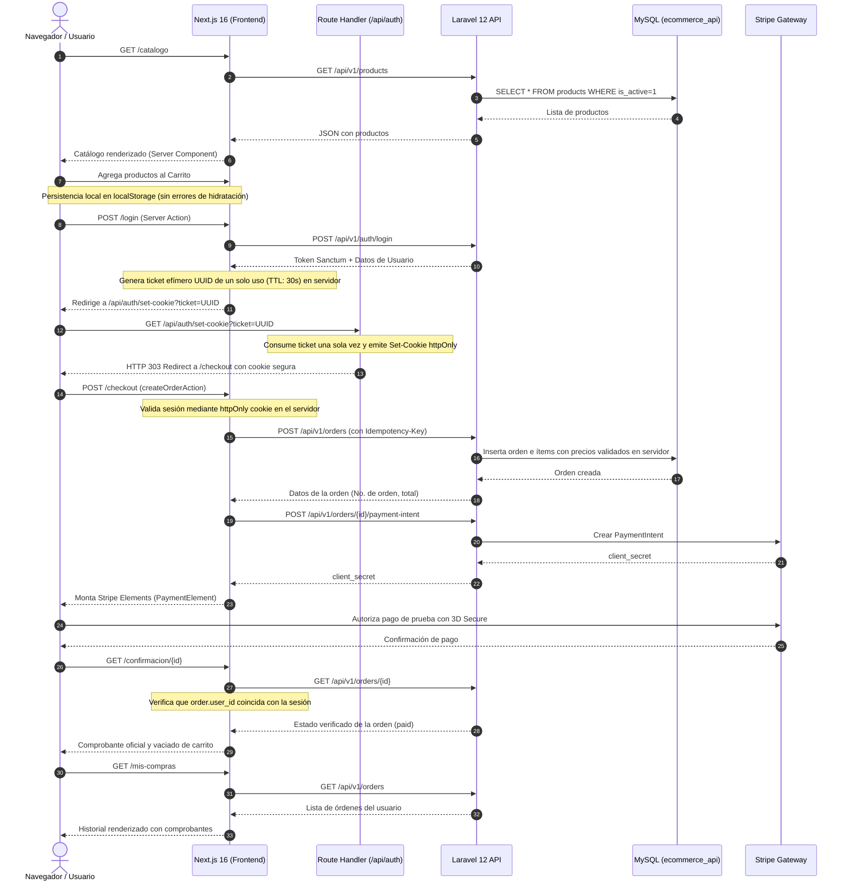

# Evidencia del Flujo Completo de Compra

Este documento describe la arquitectura y el flujo extremo a extremo verificado en la aplicación web.

---

## 1. Etapas del Flujo

---

## 2. Puntos Críticos de Seguridad Implementados

1. **Tokens estrictamente en el Servidor**:
   - El token de Laravel Sanctum nunca se escribe en el HTML, URLs, `localStorage` ni `sessionStorage`.
   - Se transporta hacia el navegador exclusivamente a través de una cookie con flags `httpOnly`, `secure` (en producción), `sameSite: 'lax'` y `path: '/'`.
2. **Mecanismo de Intercambio Efímero de un Solo Uso**:
   - La Server Action autentica contra Laravel y deposita el token en `TokenVault` con un ticket criptográfico temporal (TTL: 30 segundos).
   - El Route Handler consume el ticket exactamente una vez (`vault.delete(ticket)` inmediato). Si se reintenta, es rechazado.
3. **Validación de Propiedad en el Servidor**:
   - `/checkout`, `/mis-compras` y `/confirmacion/[id]` validan obligatoriamente la identidad del usuario y pertenencia de la orden mediante Server Components y Server Actions antes de renderizar datos o emitir comprobantes.
